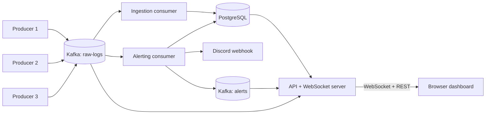

# Distributed Log Aggregation & Real-Time Alerting Engine

A mini log-aggregation platform in the spirit of ELK/Datadog. Multiple simulated
services stream logs into Kafka; independent consumers store them in PostgreSQL,
detect anomalies in real time, and push everything to a live browser dashboard
and Discord.

## Architecture



## Tech stack

Node.js, Express, Apache Kafka (KRaft mode), PostgreSQL, WebSocket (`ws`),
Docker Compose, plain HTML/CSS/JS (no frontend framework).

## Features

- Multiple concurrent log producers writing to one Kafka topic
- Durable ingestion into PostgreSQL with idempotent inserts (safe against redelivery)
- Real-time alerting: error-rate threshold (5 errors / 60s per service) and critical-keyword rules
- Discord notifications with per-service cooldown to prevent alert spam
- REST API with filtering, keyword search and pagination
- Live dashboard over WebSocket, with historical search
- Horizontal scaling: parallel ingestion consumers across Kafka partitions

## Getting started

Prerequisites: Node.js 18+, Docker Desktop.

1. Clone the repo and install dependencies:
```bash
   git clone https://github.com/<your-username>/log-aggregator.git
   cd log-aggregator
   npm install
   npm run install:all
```
2. Configure notifications: copy `alerting/.env.example` to `alerting/.env` and
   paste in a Discord webhook URL.
3. Start Kafka and PostgreSQL (tables are created automatically):
```bash
   docker compose up -d
```
4. Start all services:
```bash
   npm start
```
5. Open http://localhost:4000

## Design decisions

- **Why Kafka?** It decouples producers from consumers. Producers write fast and
  never wait on the database; consumers read at their own pace; nothing is lost
  if a consumer is down, because Kafka retains messages and tracks offsets.
- **Why separate consumer groups?** `ingestion-group`, `alerting-group` and
  `dashboard-group` each receive a full copy of the stream, so each concern
  scales and fails independently.
- **Why PostgreSQL?** Logs have a fixed structure and are queried with
  relational filters (service, level, time range), which SQL and indexes handle well.
- **Why idempotent inserts?** Kafka guarantees at-least-once delivery, so a crash
  can redeliver a message. A unique index plus `ON CONFLICT DO NOTHING` makes
  redelivery harmless.
- **Why do infrastructure errors propagate?** If PostgreSQL is down, the consumer
  lets the error surface so Kafka retries, instead of swallowing it and losing the log.

## Known limitations

- Single Kafka broker (no broker-level fault tolerance). A production setup
  would use multiple brokers with a replication factor above 1.
- The alerting consumer keeps its sliding window in memory, so it runs as a
  single instance. Scaling it out would require keying messages by service.
- Credentials are hardcoded for local development.

## Project structure

```
producers/   fake services that generate logs
ingestion/   Kafka -> PostgreSQL consumer
alerting/    rule engine + Discord notifications
api/         Express REST API + WebSocket server + dashboard hosting
dashboard/   plain HTML/JS dashboard
db/          SQL schema
```